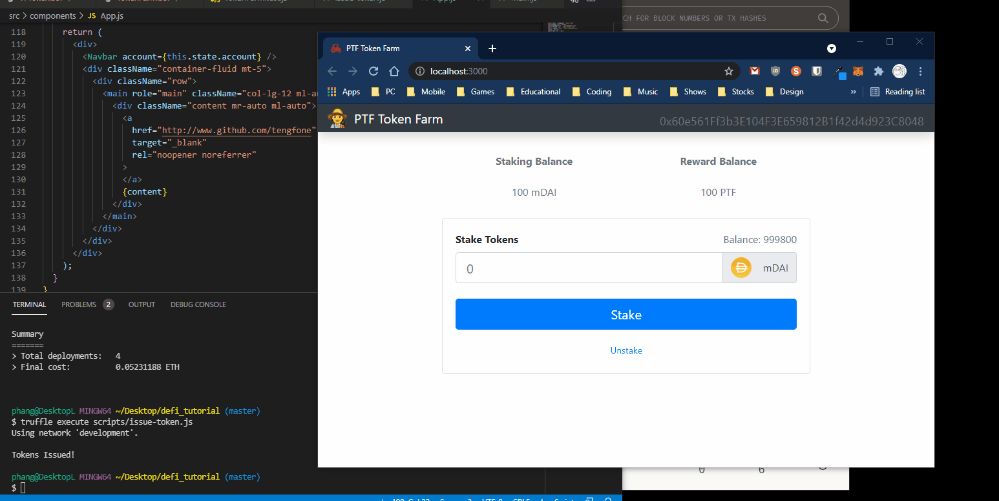

# PTF Token Farm (Liquidity Farming)

## DeFi App  

To test out Solidity and Web3js.  

## Demo  



## Front-end

The React front-end is built with [Vite](https://vite.dev/):

```bash
npm install
npm start          # dev server on http://localhost:3000
npm run build      # production build into build/
npm run preview    # serve the production build locally
```

## Smart contracts

Truffle is no longer a project dependency: it is only needed to compile,
migrate and test the contracts, not to build the deployed front-end, and it
pulled in hundreds of vulnerable packages. Install the contract tooling
separately when you need it, for example:

```bash
npm install -g truffle@5
npm install --no-save chai@4 chai-as-promised@7 chai-bignumber@3
truffle migrate --reset
truffle test
```

## Execute Script  

```bash
truffle execute scripts/issue-token.js
```

## Credits  

Tutorial from https://youtu.be/CgXQC4dbGUE